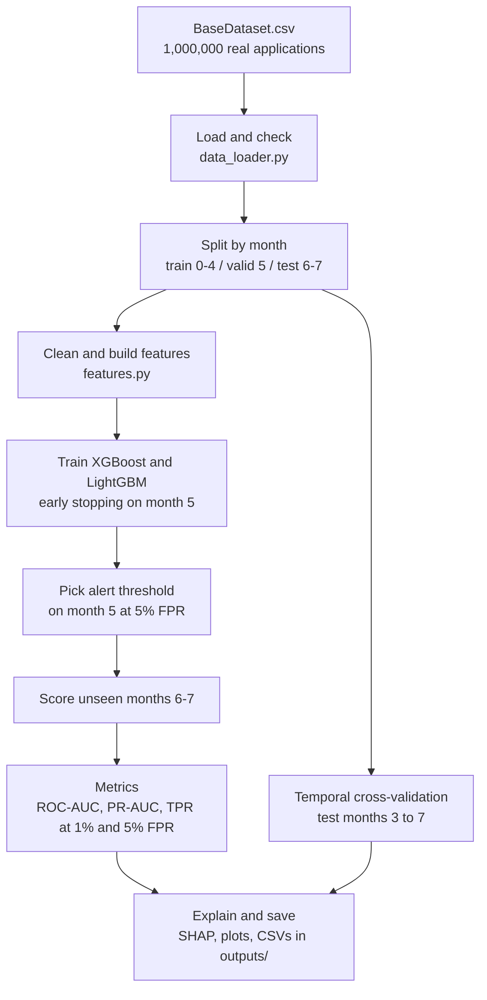

# Bank Account Fraud Detection (NeurIPS 2022 Benchmark)

Fraud detection with **XGBoost** and **LightGBM** on the real
[Bank Account Fraud](https://www.kaggle.com/datasets/sgpjesus/bank-account-fraud-dataset-neurips-2022)
benchmark (`BaseDataset.csv`). **No synthetic or mock data is used anywhere in this repo.**

---

## 1. Dataset

| Item | Value |
|---|---|
| File | `data/BaseDataset.csv` (~213 MB, not stored in Git) |
| Rows | 1,000,000 account applications |
| Columns | 31 features + target `fraud_bool` |
| Fraud rate | about 1.10% (11,029 frauds) |
| Time column | `month` (0 to 7), used only for splitting, never as a feature |

Download it from Kaggle and place it at `data/BaseDataset.csv`.
To keep it elsewhere, use `--data PATH` or set the `BASE_DATASET_PATH` environment variable.

---

## 2. Quick start

```bash
# 1. Create and activate a virtual environment
python -m venv .venv
source .venv/bin/activate          # Windows: .venv\Scripts\activate

# 2. Install dependencies
pip install -r requirements.txt

# 3. Put BaseDataset.csv in the data/ folder

# 4. Quick test on 10% of the real rows (a few minutes)
python src/train.py --sample-frac 0.1 --skip-cv --skip-shap

# 5. Sanity tests
pytest tests

# 6. Full run (all rows + cross-validation + SHAP; can take a long time)
python src/train.py
```

Useful options:

| Option | Meaning |
|---|---|
| `--data PATH` | Use a CSV from another location |
| `--output-dir DIR` | Write results somewhere other than `outputs/` |
| `--sample-frac 0.1` | Use a random 10% of the real rows (smoke tests only) |
| `--skip-cv` | Skip temporal cross-validation |
| `--skip-shap` | Skip SHAP explanations |
| `--seed 42` | Random seed |

---

## 3. How the pipeline works



| Step | What happens |
|---|---|
| Split | Time-based, never random. Train = months 0-4, validation = month 5, test = months 6-7. Learn from the past, evaluate on unseen future. |
| Missing values | `-1` in 5 columns and negative `intended_balcon_amount` mean "unknown". Converted to NaN, plus informative `_missing` indicator flags. |
| Behavioral Graph & Velocity Features | Bipartite entity degree products (`device_distinct_emails_8w` × `dob_distinct_emails_4w`), graph hub centrality score, device recycling speed, velocity surge intensity, burst acceleration, credit leverage strain, and frozen training baseline drift z-scores. |
| Imbalanced Learning | Specialized class weighting (`scale_pos_weight`) or custom binary Focal Loss (`--loss focal`), plus in-fold SMOTE resampling (`--resample smote`) strictly within training windows with zero leakage. |
| Cost-Sensitive Optimization | Financial loss matrix ($C_{FN}=\$1500$, $C_{FP}=\$30$, $C_{TP}=\$10$) optimizing decision thresholds for minimum expected bank dollar loss and plotting operational cost curves. |
| Statistical Significance | Exact asymptotic DeLong's test comparing correlated ROC-AUCs on the test set, plus paired Student's t-test and Wilcoxon signed-rank test across temporal CV folds with Cohen's d effect size. |
| Adversarial Robustness | Evasion stress-testing across perturbation budgets $\varepsilon \in [0.05, 0.30]$ simulating fraudster device spoofing and velocity throttling. |
| Regulatory XAI | Global SHAP summary bar/beeswarm, feature interaction dependence plots, and adverse action audit cards aligned with RBI Digital Lending Guidelines and Basel III / Fed SR 11-7 model risk governance. |

---

## 4. Metrics explained

Each application gets a fraud score between 0 and 1. A cutoff decides what gets flagged.

| Metric | Meaning in simple words |
|---|---|
| **ROC-AUC** | Chance that a random fraud gets a higher score than a random good customer. 0.5 = coin flip, 1.0 = perfect. |
| **PR-AUC** | How precise the alerts are across all cutoffs. More honest than ROC-AUC when fraud is rare (about 1%). A random model scores about 0.01. |
| **TPR at 5% FPR** | Share of all frauds caught while wrongly flagging only 5% of good customers. This is the benchmark's standard operating point. |
| **TPR at 1% FPR** | Same idea with a stricter limit of 1% false alarms. |
| Precision / Recall / F1 | Computed at the threshold chosen on the validation month. |

---

## 5. Repository layout

```
.
├── data/
│   ├── README.md          where to put BaseDataset.csv
│   └── .gitkeep
├── src/
│   ├── config.py          paths, schema, split months, hyper-parameters
│   ├── data_loader.py     CSV loading, validation, temporal split
│   ├── features.py        leakage-safe preprocessing and feature engineering
│   ├── evaluation.py      metrics and plots
│   └── train.py           end-to-end entry point
├── tests/
│   └── test_pipeline.py   sanity and leakage tests on real data
├── scripts/
│   └── git_cleanup.sh     one-time cleanup of old synthetic files
├── outputs/               generated results (models/ is git-ignored)
├── requirements.txt
└── README.md
```

---

## 6. Outputs

Running `python src/train.py` writes to `outputs/`:

| File | Content |
|---|---|
| `model_metrics_table.csv` | Test-set metrics for both models |
| `cv_results_5fold_temporal.csv`, `cv_summary_5fold_temporal.csv` | Cross-validation results |
| `feature_importance_xgboost.csv`, `feature_importance_lightgbm.csv` | Gain importance |
| `shap_feature_importance_lgbm.csv` | Mean absolute SHAP values |
| `roc_curve.png`, `precision_recall_curve.png` | Performance curves |
| `fraud_probability_distribution.png` | Score distribution, fraud vs good |
| `lightgbm_feature_importance.png`, `shap_bar_lgbm.png`, `shap_beeswarm_lgbm.png` | Explainability plots |
| `test_predictions.csv`, `models/` | Predictions and saved models (git-ignored) |

---

## 7. Results

Run the full pipeline and paste your numbers from `outputs/model_metrics_table.csv`:

| Model | ROC-AUC | PR-AUC | TPR at 1% FPR | TPR at 5% FPR |
|---|---|---|---|---|
| XGBoost | _fill in_ | _fill in_ | _fill in_ | _fill in_ |
| LightGBM | _fill in_ | _fill in_ | _fill in_ | _fill in_ |

---

## 8. Configuration

All settings are in `src/config.py`: dataset path, split months, XGBoost/LightGBM
parameters, target FPR, and `EXTRA_EXCLUDE_FEATURES`.

## 9. Responsible use

The data includes sensitive attributes such as `customer_age`. Add any attribute you
want removed to `EXTRA_EXCLUDE_FEATURES` in `config.py`. This is a research and
portfolio project, not a production fraud system.

## 10. License and data credit

Dataset: *Bank Account Fraud (BAF) Dataset Suite*, NeurIPS 2022 (Jesus et al.).
Please follow the dataset's own license and citation terms.
